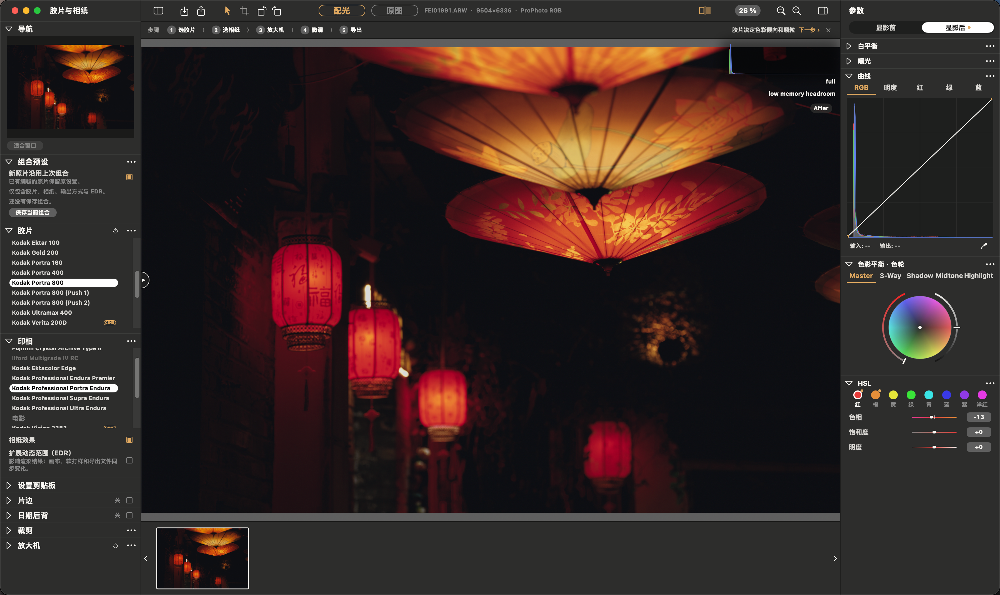
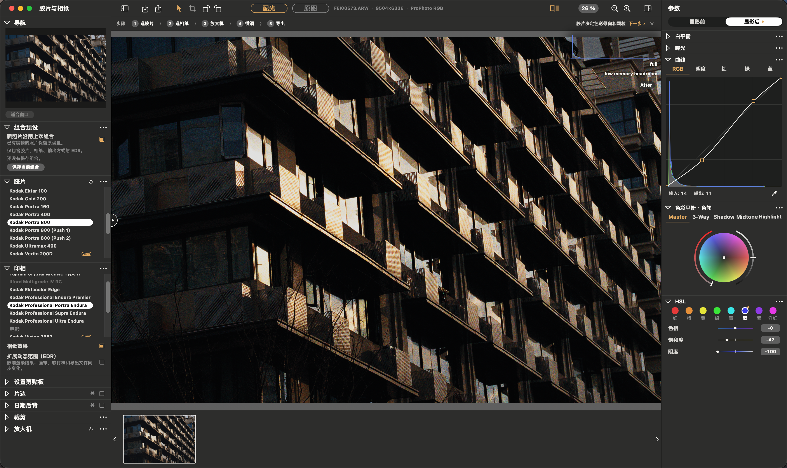
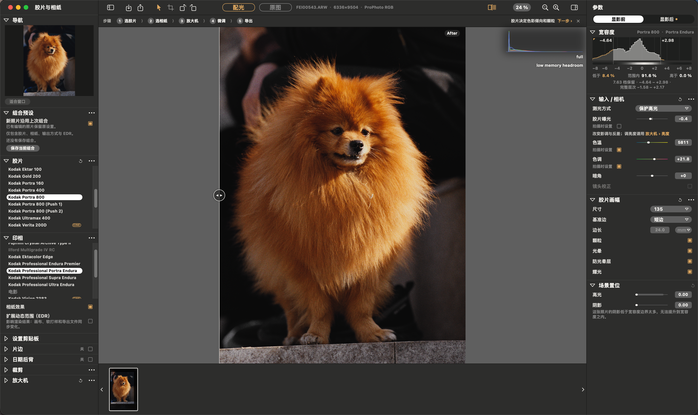
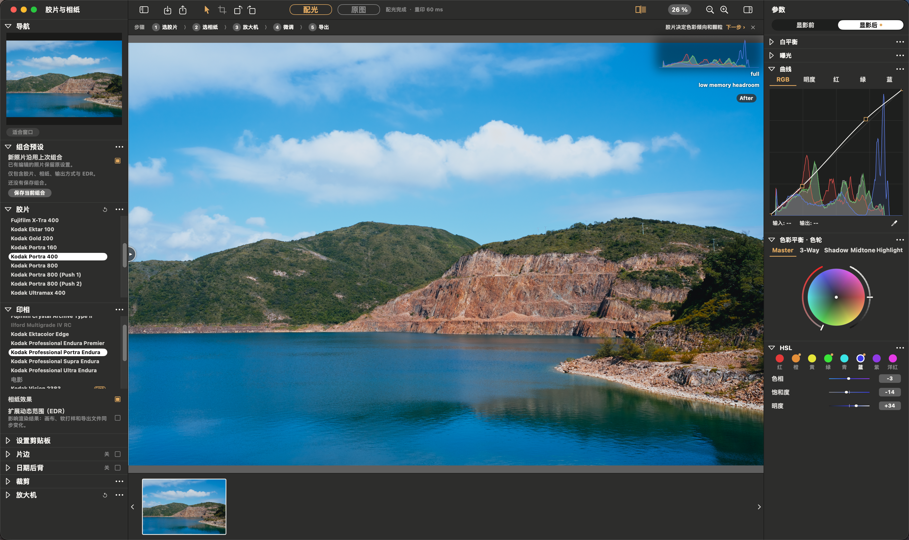
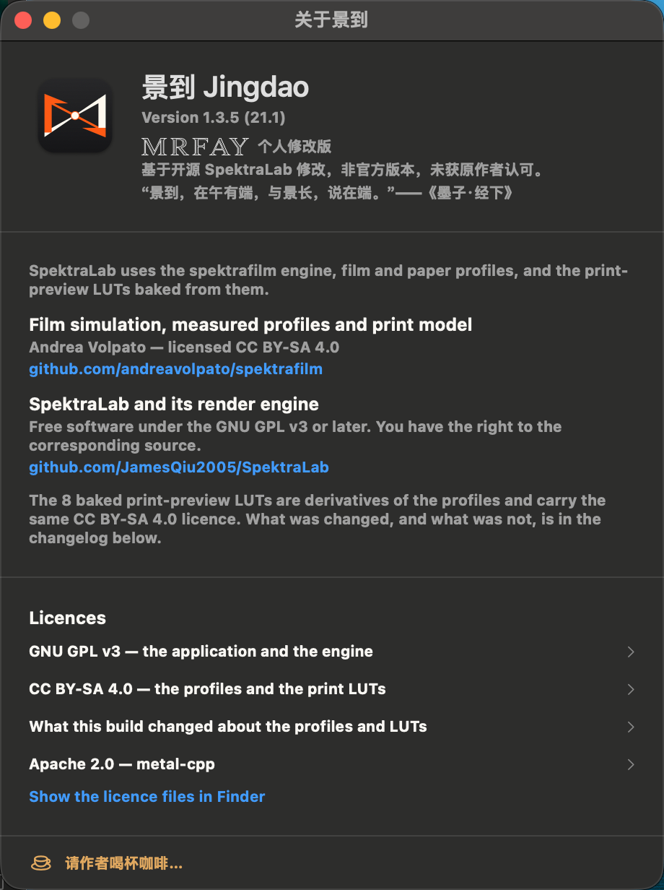

# 景到 Jingdao

[简体中文](README.md) · [English](README.en.md) · **日本語** · [한국어](README.ko.md)

**オープンソースの [SpektraLab](https://github.com/JamesQiu2005/SpektraLab) 1.3.5 をベースにした非公式改変版**。macOS 向けのフィルム・印画紙シミュレーターです。
本プロジェクトは SpektraLab の公式リリースではなく、上流プロジェクトの作者による承認も受けていません。オリジナルのドキュメントは [README.SpektraLab.md](README.SpektraLab.md)（英語）と [README.SpektraLab.zh-CN.md](README.SpektraLab.zh-CN.md)（中国語）をご覧ください。

> 名前の由来は『墨子・経下』の「景到，在午有端，与景長，説在端」。小さな穴を通った光が反対側に倒立像を結ぶ現象を表しています。アイコンもピンホールによる結像をモチーフにしています。

## 製品概要

[](screenshots/jingdao-21.1/overview.png)

## SpektraLab 1.3.5 からの変更点

| バージョン | 変更内容 |
|---|---|
| 20.6 | スライダー操作の応答性を改善。レンダリング開始までの待ち時間を短縮し、新しい編集操作が入ると実行中のフル解像度レンダリングをキャンセル |
| 20.7 | 「景到（Jingdao）」に改名。ピンホールをモチーフにしたアイコンを採用 |
| 20.8 | 初心者向けガイドを追加。画像未読込時のヒントと、上部のステップバー（フィルム → 印画紙 → 引き伸ばし機 → 微調整 → 書き出し） |
| 20.9 | 回転ボタン、中国語 UI、「このアプリについて」のロゴタイプ、任意の寄付ウィンドウ |
| 21.0 | フィルム処理の段階別キャッシュを導入。フィルム露光量・粒状感・DIR の調整時のプレビューを高速化（Apple M4 実測で約 4.7 → 6.0 フレーム/秒）。書き出し品質は維持 |
| 21.1 | 現像後の調整に **HSL** を追加（赤・オレンジ・黄・緑・アクア・青・紫・マゼンタ × 色相・彩度・輝度）。中国語 UI のカラーバランス項目に「色輪」を明記 |

そのほか、フィルムと印画紙の組み合わせプリセット、書き出し設定の記憶、透過 PNG の署名レイヤー、パネルの並べ替え、中国語メニューなどを追加しています。

アプリの表示言語はシステム設定に従い、英語または簡体字中国語になります。この README は日本語訳です。紹介画像内の文字とスクリーンショットは中国語のまま掲載しています。

## 操作画面と作例

Jingdao 21.1 の簡体字中国語 UI を実際に撮影したスクリーンショットです。画像をクリックすると原寸で確認できます。

<table>
  <tr>
    <td width="50%" align="center">
      <a href="screenshots/jingdao-21.1/lanterns.png"></a><br>
      <sub>提灯の夜景 · トーンカーブ・カラーホイール・HSL</sub>
    </td>
    <td width="50%" align="center">
      <a href="screenshots/jingdao-21.1/architecture.png"></a><br>
      <sub>建築 · 光と影</sub>
    </td>
  </tr>
  <tr>
    <td width="50%" align="center">
      <a href="screenshots/jingdao-21.1/portrait.png"></a><br>
      <sub>ペットのポートレート · フィルム露光量と粒状感</sub>
    </td>
    <td width="50%" align="center">
      <a href="screenshots/jingdao-21.1/landscape.png"></a><br>
      <sub>湖と山の風景 · 色と階調</sub>
    </td>
  </tr>
</table>

### Jingdao について

バージョン情報、非公式改変版であることの説明、上流プロジェクトへの謝辞とライセンスを確認できます。

<p align="center">
  <a href="screenshots/jingdao-21.1/about.png"></a>
</p>

## 入手とビルド

このリポジトリで公開しているのは**ソースコードのみ**です。インストーラーは配布していません。詳細は [PERSONAL-BUILD.txt](PERSONAL-BUILD.txt)（中国語）を参照してください。

1. Apple シリコン搭載 Mac（macOS 15 以降）と Xcode / Command Line Tools を用意します。
2. 公式の SpektraLab 1.3.5 を `/Applications/SpektraLab.app` にインストールします。ビルドスクリプトは、そこに含まれる未変更の公式リソースを読み込みます。
3. リポジトリのルートディレクトリから次のコマンドを実行します。

   ```sh
   cd modern_UI/Spektrafilm
   Tools/build-personal.sh
   ```

   ローカルで ad-hoc 署名された `景到.app` が生成されます。

ビルドスクリプトは公式 1.3.5 を基準に検証します。エンジンのリソース、シェーダーライブラリ、フィルムデータは公式版と同一に保ち、`engine/src/pipeline` 内の 3 つの C++ ファイルだけに差分を許可します。21.1 の HSL シェーダーは `Canvas/HSLKernel.swift` にあり、実行時にコンパイルされるため、公式のシェーダーライブラリは変更しません。

## ライセンスと謝辞

- アプリとエンジン：GPL-3.0-or-later（[LICENSE.txt](LICENSE.txt) を参照）。
- フィルム・印画紙プロファイルと LUT：CC BY-SA 4.0。Andrea Volpato 氏の [spektrafilm](https://github.com/andreavolpato/spektrafilm) に由来します。
- オリジナルの作者：SpektraLab、[JamesQiu2005/SpektraLab](https://github.com/JamesQiu2005/SpektraLab)。
- SpektraLab の名称とアイコンは上流プロジェクトに帰属します。Jingdao の名称とアイコンには、上流の名称・ロゴやそれらの派生図形は含まれていません。
- 寄付用コードの元画像は、このリポジトリには含まれていません。アプリ内の寄付は完全に任意で、機能の解放とは関係ありません。寄付先はこの改変版の作者であり、上流プロジェクトの作者とは無関係です。

## 連絡先

mrfay · mrfayshenzhen66@gmail.com
