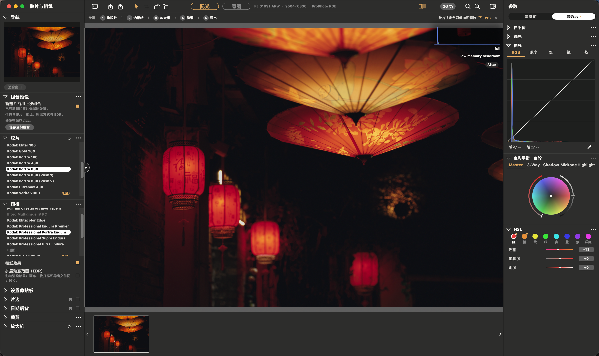
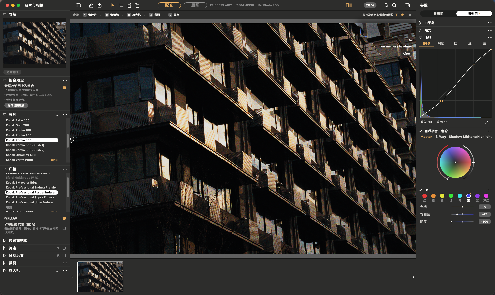
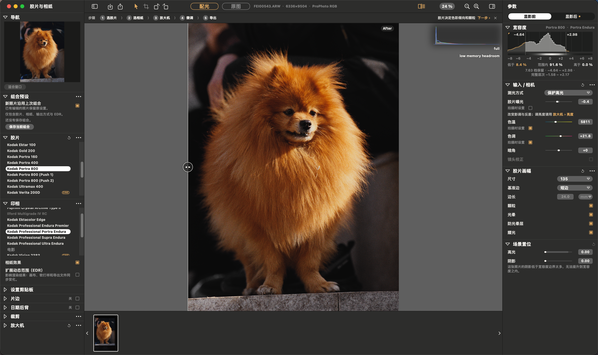
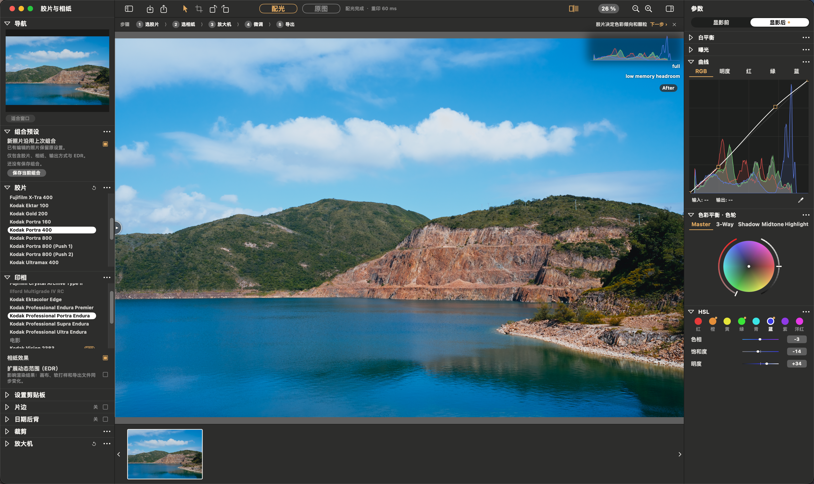
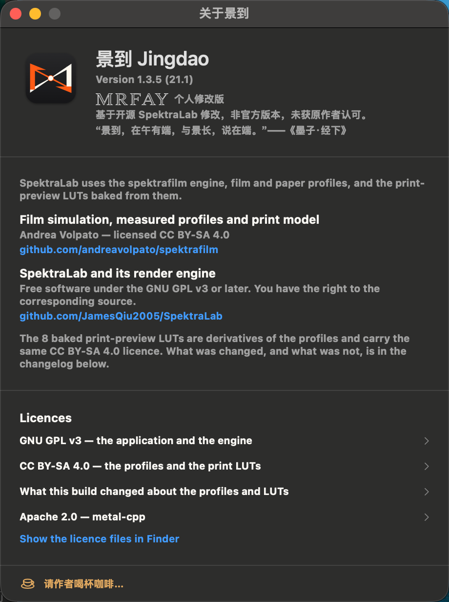

# 景到 Jingdao

[简体中文](README.md) · [English](README.en.md) · [日本語](README.ja.md) · **한국어**

**오픈 소스 [SpektraLab](https://github.com/JamesQiu2005/SpektraLab) 1.3.5를 기반으로 한 비공식 수정 버전**으로, macOS용 필름 및 인화지 시뮬레이터입니다.
이 프로젝트는 SpektraLab의 공식 배포판이 아니며, 원작자의 승인을 받지 않았습니다. 원본 문서는 [README.SpektraLab.md](README.SpektraLab.md)(영어)와 [README.SpektraLab.zh-CN.md](README.SpektraLab.zh-CN.md)(중국어)에서 확인할 수 있습니다.

> 이름은 『묵자·경하』의 “景到，在午有端，与景长，说在端。”에서 따왔습니다. 작은 구멍을 통과한 빛이 반대편에 거꾸로 된 상을 맺는 현상을 뜻하며, 아이콘 역시 바늘구멍에 의한 결상을 표현합니다.

## 제품 소개

[](screenshots/jingdao-21.1/overview.png)

## SpektraLab 1.3.5 대비 변경 사항

| 버전 | 변경 내용 |
|---|---|
| 20.6 | 슬라이더 조작 반응 개선: 렌더링 예약 대기 시간을 줄이고, 새로운 편집이 시작되면 진행 중인 원본 해상도 렌더링을 취소 |
| 20.7 | 이름을 “景到(Jingdao)”로 변경하고 바늘구멍을 모티프로 한 아이콘 적용 |
| 20.8 | 초보자 안내 추가: 이미지가 없는 화면의 도움말과 상단 단계 표시줄(필름 → 인화지 → 확대기 → 미세 조정 → 내보내기) |
| 20.9 | 회전 버튼, 중국어 UI, 앱 정보 창의 로고타입, 선택적 후원 창 추가 |
| 21.0 | 필름 처리 단계별 캐시 도입: 필름 노출·입자·DIR 조정 시 미리보기 속도 향상(Apple M4 실측 약 4.7 → 6.0프레임/초). 내보내기 화질 유지 |
| 21.1 | 현상 후 조정에 **HSL** 추가(빨강·주황·노랑·초록·아쿠아·파랑·보라·마젠타 × 색조·채도·명도). 중국어 UI의 색상 균형 항목에 색상환 표기 추가 |

그 밖에 필름·인화지 조합 프리셋, 내보내기 설정 기억, 투명 PNG 서명 레이어, 패널 순서 변경, 중국어 메뉴 등이 추가되었습니다.

앱의 표시 언어는 시스템 설정에 따라 영어 또는 중국어 간체로 제공됩니다. 이 README는 한국어 번역이며, 소개 이미지와 스크린샷 안의 문구는 중국어 원본을 유지했습니다.

## 화면과 작업 예시

Jingdao 21.1의 중국어 간체 UI를 실제로 캡처한 화면입니다. 이미지를 클릭하면 원본 크기로 볼 수 있습니다.

<table>
  <tr>
    <td width="50%" align="center">
      <a href="screenshots/jingdao-21.1/lanterns.png"></a><br>
      <sub>등불 야경 · 커브·색상환·HSL</sub>
    </td>
    <td width="50%" align="center">
      <a href="screenshots/jingdao-21.1/architecture.png"></a><br>
      <sub>건축 · 빛과 그림자</sub>
    </td>
  </tr>
  <tr>
    <td width="50%" align="center">
      <a href="screenshots/jingdao-21.1/portrait.png"></a><br>
      <sub>반려동물 사진 · 필름 노출과 입자</sub>
    </td>
    <td width="50%" align="center">
      <a href="screenshots/jingdao-21.1/landscape.png"></a><br>
      <sub>호수와 산 풍경 · 색감과 계조</sub>
    </td>
  </tr>
</table>

### Jingdao 정보

버전 정보, 비공식 수정 버전 안내, 원본 프로젝트에 대한 감사의 말과 라이선스를 확인할 수 있습니다.

<p align="center">
  <a href="screenshots/jingdao-21.1/about.png"></a>
</p>

## 소스 받기 및 빌드

이 저장소는 **소스 코드만 제공**하며, 설치 파일은 배포하지 않습니다. 자세한 방법은 [PERSONAL-BUILD.txt](PERSONAL-BUILD.txt)(중국어)를 참고하세요.

1. Apple Silicon Mac(macOS 15 이상)과 Xcode / Command Line Tools를 준비합니다.
2. 공식 SpektraLab 1.3.5를 `/Applications/SpektraLab.app`에 설치합니다. 빌드 스크립트는 여기에 포함된 수정되지 않은 공식 리소스를 읽습니다.
3. 저장소의 최상위 폴더에서 다음 명령을 실행합니다.

   ```sh
   cd modern_UI/Spektrafilm
   Tools/build-personal.sh
   ```

   로컬에서 ad-hoc 서명된 `景到.app`이 생성됩니다.

빌드 스크립트는 공식 1.3.5 버전을 기준으로 검증합니다. 엔진 리소스, 셰이더 라이브러리, 필름 데이터는 공식 버전과 동일하게 유지하며, `engine/src/pipeline` 아래의 C++ 파일 3개에만 차이를 허용합니다. 21.1의 HSL 셰이더는 `Canvas/HSLKernel.swift`에 있으며 실행 시 컴파일되므로, 공식 셰이더 라이브러리는 변경하지 않습니다.

## 라이선스 및 감사의 말

- 앱과 엔진: GPL-3.0-or-later([LICENSE.txt](LICENSE.txt) 참고).
- 필름·인화지 프로파일과 LUT: CC BY-SA 4.0. Andrea Volpato의 [spektrafilm](https://github.com/andreavolpato/spektrafilm)에서 가져왔습니다.
- 원작자: SpektraLab, [JamesQiu2005/SpektraLab](https://github.com/JamesQiu2005/SpektraLab).
- SpektraLab의 이름과 아이콘은 원본 프로젝트에 귀속됩니다. Jingdao의 이름과 아이콘에는 원본 프로젝트의 이름·로고 또는 이를 변형한 도형이 포함되어 있지 않습니다.
- 후원 코드의 원본 이미지는 이 저장소에 포함되어 있지 않습니다. 앱 내 후원은 전적으로 선택 사항이며, 후원 여부에 따라 기능이 추가로 해제되지 않습니다. 후원금 수령인은 이 수정 버전의 제작자이며 원작자와는 무관합니다.

## 연락처

mrfay · mrfayshenzhen66@gmail.com
