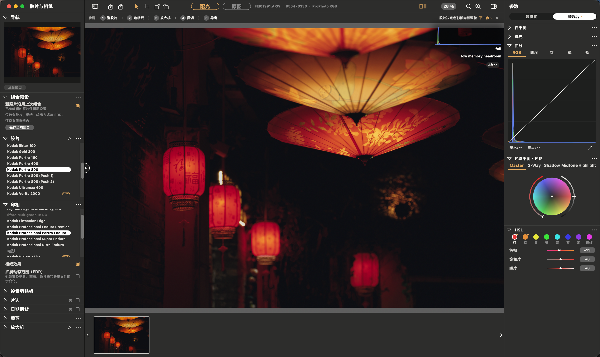
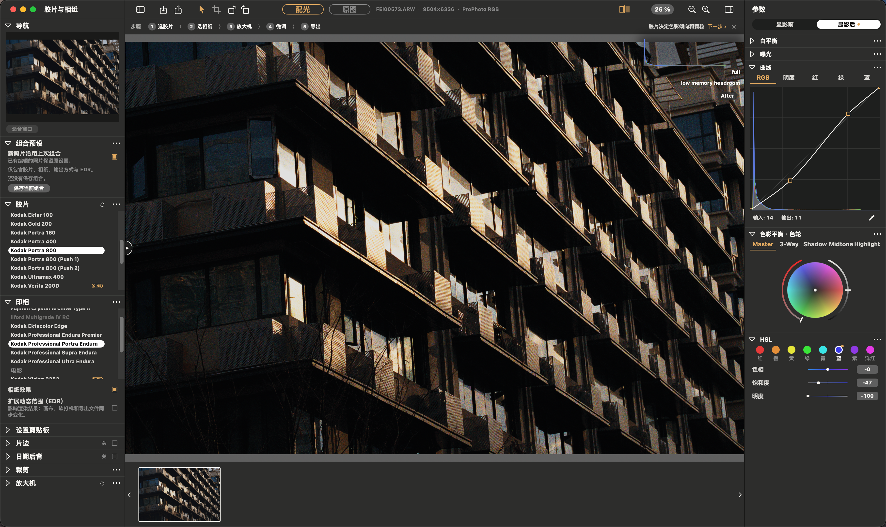
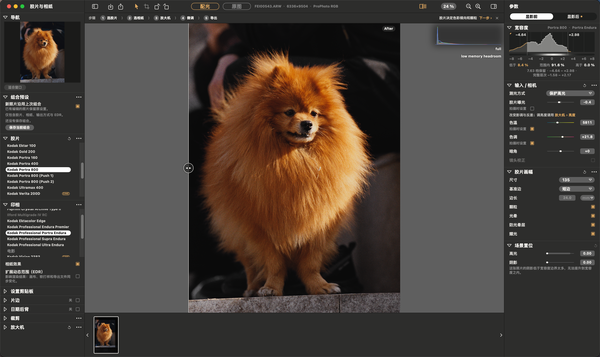
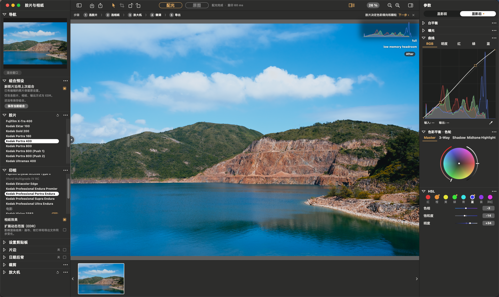
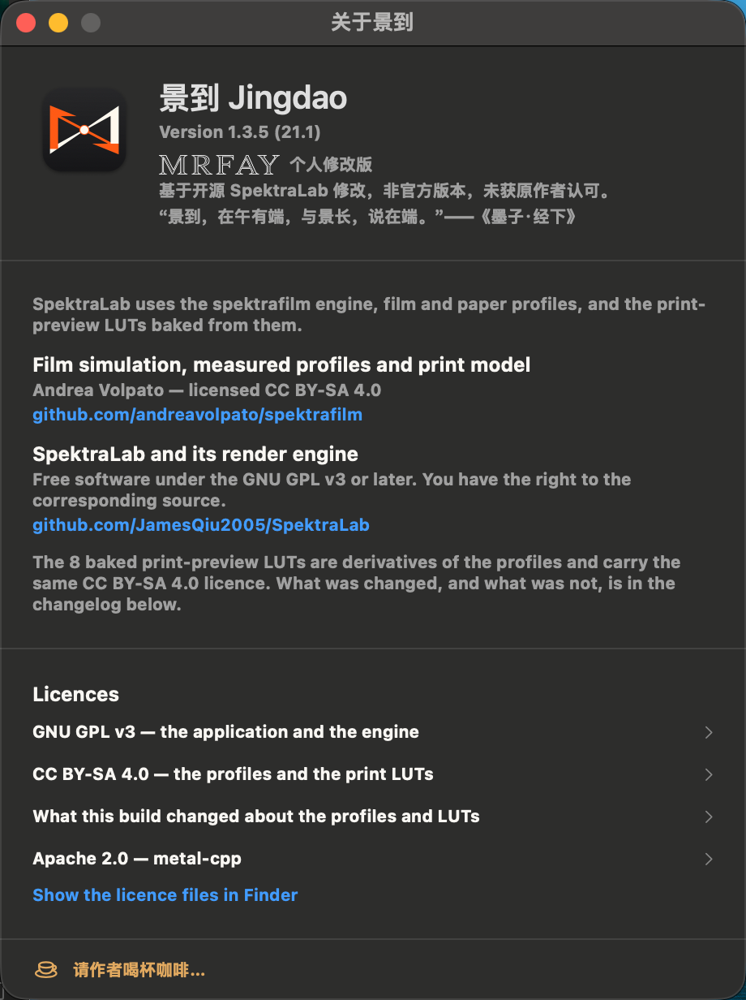

# 景到 Jingdao

**简体中文** · [English](README.en.md)

**基于开源 [SpektraLab](https://github.com/JamesQiu2005/SpektraLab) 1.3.5 的非官方修改版**，macOS 胶片与相纸冲印模拟器。
本项目不是 SpektraLab 官方发行，也未获得上游作者认可。上游原始说明见 [README.SpektraLab.zh-CN.md](README.SpektraLab.zh-CN.md)（中文）与 [README.SpektraLab.md](README.SpektraLab.md)（English）。

> 名字出自《墨子·经下》：“景到，在午有端，与景长，说在端。”——光线穿过小孔，在另一侧成倒立的像。图标画的就是小孔成像。

## 产品概览

[](screenshots/jingdao-21.1/overview.png)

## 相比 SpektraLab 1.3.5 的改动

| 版本 | 内容 |
|---|---|
| 20.6 | 拖动调色更跟手：渲染调度等待缩短，新编辑会取消正在进行的原分辨率渲染 |
| 20.7 | 改名“景到”，小孔成像图标 |
| 20.8 | 新手引导：空白页提示、顶部步骤条（选胶片 → 选相纸 → 放大机 → 微调 → 导出） |
| 20.9 | 旋转按钮、界面中文化、关于页字标、自愿打赏窗口 |
| 21.0 | 胶片分段缓存：拖动胶片曝光、颗粒、DIR 时预览更快（Apple M4 实测约 4.7 → 6.0 次/秒），导出画质不变 |
| 21.1 | 显影后新增 **HSL**（红橙黄绿青蓝紫洋红 × 色相/饱和度/明度）；“色彩平衡”改名“色彩平衡 · 色轮” |

另有：胶片与相纸组合预设、导出配方记忆、透明 PNG 签名图层、栏目排序管理、中文菜单等。

## 界面与效果

景到 21.1 中文界面实拍。点击图片可查看原图。

<table>
  <tr>
    <td width="50%" align="center">
      <a href="screenshots/jingdao-21.1/lanterns.png"></a><br>
      <sub>灯笼夜景 · 曲线、色轮与 HSL</sub>
    </td>
    <td width="50%" align="center">
      <a href="screenshots/jingdao-21.1/architecture.png"></a><br>
      <sub>建筑光影 · 明暗层次</sub>
    </td>
  </tr>
  <tr>
    <td width="50%" align="center">
      <a href="screenshots/jingdao-21.1/portrait.png"></a><br>
      <sub>宠物肖像 · 胶片曝光与颗粒</sub>
    </td>
    <td width="50%" align="center">
      <a href="screenshots/jingdao-21.1/landscape.png"></a><br>
      <sub>湖山风景 · 色彩与影调</sub>
    </td>
  </tr>
</table>

### 关于景到

版本信息、非官方修改版说明，以及上游项目的致谢与许可。

<p align="center">
  <a href="screenshots/jingdao-21.1/about.png"></a>
</p>

## 获取与构建

本仓库**只提供源码**，不提供安装包。构建方法见 [PERSONAL-BUILD.txt](PERSONAL-BUILD.txt)，简要步骤：

1. 准备 Apple 芯片 Mac（macOS 15 或更高）与 Xcode / Command Line Tools。
2. 安装官方 SpektraLab 1.3.5 到 `/Applications/SpektraLab.app`（构建脚本会读取其中未修改的官方资源）。
3. 在本仓库根目录运行：

   ```sh
   cd modern_UI/Spektrafilm
   Tools/build-personal.sh
   ```

   产物为本地 ad-hoc 签名的 `景到.app`。

构建脚本会核对官方 1.3.5 基线：引擎资源、着色器库和胶片数据与官方保持一致，只允许 `engine/src/pipeline` 下三个 C++ 文件不同。21.1 的 HSL 着色器写在 `Canvas/HSLKernel.swift`，运行时编译，不改动官方着色器库。

## 许可与致谢

- 应用与引擎：GPL-3.0-or-later（见 [LICENSE.txt](LICENSE.txt)）。
- 胶片/相纸配置与 LUT：CC BY-SA 4.0，来源 [spektrafilm](https://github.com/andreavolpato/spektrafilm)（Andrea Volpato）。
- 原作者：SpektraLab，[JamesQiu2005/SpektraLab](https://github.com/JamesQiu2005/SpektraLab)。
- SpektraLab 名称与图标归上游所有，景到的名称和图标不含上游名称、Logo 或其衍生图形。
- 打赏码原图不在仓库中；应用内的打赏窗口完全自愿，不解锁任何功能，收款人是本修改版作者，与上游作者无关。

## 联系

mrfay · mrfayshenzhen66@gmail.com
